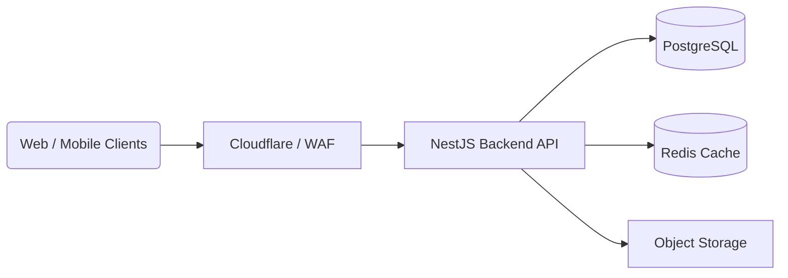

# Matrimony Application Architecture

This document provides a simple, high-level overview of the Matrimony application architecture. It is designed to be easily understandable for developers, stakeholders, and new team members.

## 🏗️ High-Level Architecture Overview

The system is built using a modern, decoupled architecture. This ensures that the application is scalable, secure, and easy to maintain.

### 1. Frontend (Client Layer)
- **Technology:** Next.js (React)
- **Role:** Handles the user interface and user experience. 
- **Communication:** Communicates with the backend via REST APIs over HTTP.
- **Why?** Next.js provides excellent performance, SEO capabilities, and a great developer experience.

### 2. Edge & Security Layer
- **Technology:** Cloudflare / Web Application Firewall (WAF)
- **Role:** Protects the application from malicious traffic, provides DDoS protection, and caches static assets closer to the user for faster load times.

### 3. Backend (API Layer)
- **Technology:** NestJS (Node.js)
- **Role:** The core brain of the application. It handles business logic, authentication, data processing, and coordinates between the database and the client.
- **Key Modules & Tools:**
  - **Prisma:** Modern ORM (Object-Relational Mapping) for secure and type-safe database interactions.
  - **Argon2 & JWT:** Secure password hashing and token-based authentication.
  - **Class Validator & Helmet:** For strict input validation and securing HTTP headers.
  - **Pino:** High-performance logging.
- **Why?** NestJS provides a scalable, strongly typed (TypeScript), and modular structure, making it perfect for enterprise-grade applications. It remains independently deployable to support both web and future mobile clients.

### 4. Data & Storage Layer
- **Primary Database:** PostgreSQL
  - Used for storing relational data like users, profiles, and matches.
- **Caching:** Redis
  - Used for fast data retrieval, session management, and rate limiting to reduce the load on the primary database.
- **Object Storage:** (e.g., AWS S3, Cloudflare R2)
  - Used for storing user-uploaded media like profile pictures and documents securely.

## 🚀 Local Development Setup

The local development environment uses Docker to seamlessly run the required infrastructure (Database & Cache).

- **NestJS Application:** Runs directly on your machine via Node.js (`npm run start:dev`).
- **PostgreSQL & Redis:** Run inside Docker containers (configured via `docker-compose.yml`).
- **Prisma:** Manages database schemas and migrations (`prisma/schema.prisma`).

## 🔐 Security Features
- **Data Protection:** Passwords are hashed using `Argon2` before being saved.
- **API Security:** `Helmet` is used to set secure HTTP headers, and strict CORS policies are enforced.
- **Validation:** All incoming API requests are strictly validated using `class-validator` to prevent injection and bad data.

## 📂 Project Structure Snapshot
- `/src` - Core backend logic, controllers, and services.
- `/src/health` - Health check endpoints for monitoring.
- `/prisma` - Database schema definitions and migrations.
- `docker-compose.yml` - Infrastructure definition for local development.
